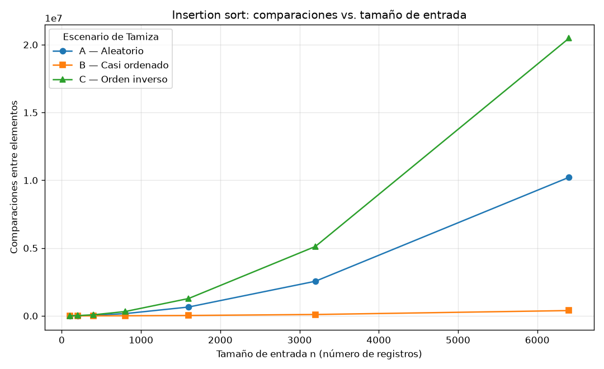
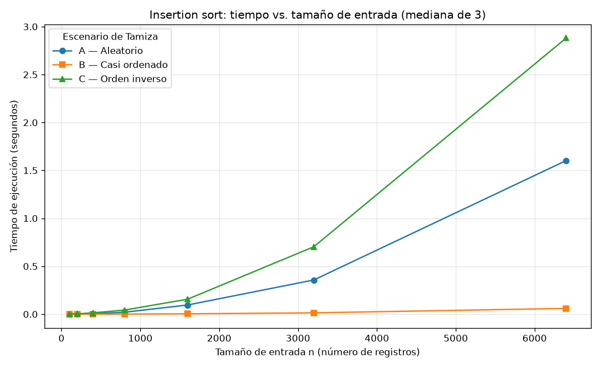
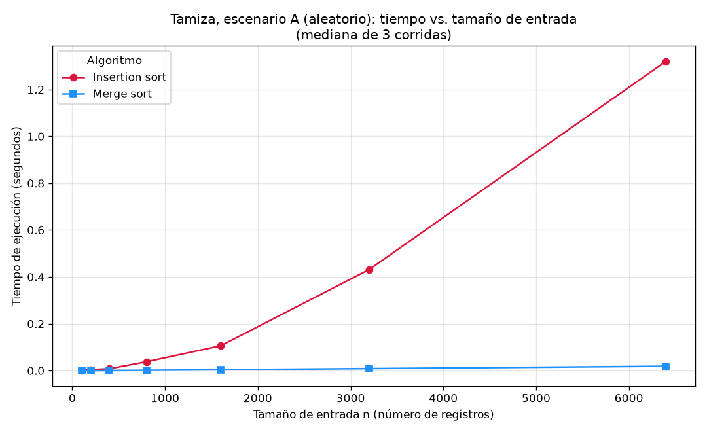

# Laboratorio 1 — Fundamentos, complejidad y recurrencias (plataforma Tamiza)

**Estudiante:** Juliana Gómez Legarda
**Curso:** Análisis de Algoritmos

## Instrucciones para reproducir el experimento

Los comandos se corren desde la raíz del repositorio (`curso-analisis-algoritmos/`).

1. Activar el entorno virtual:

   ```bash
   # Windows (PowerShell o cmd)
   venv\Scripts\activate
   ```

2. Instalar las dependencias, entre ellas `matplotlib`:

   ```bash
   pip install -r requirements.txt
   ```

3. Parte 3 (insertion sort sobre los tres escenarios). Se demora unos 15 segundos y deja `graficas/parte3_comparaciones.png` y `graficas/parte3_tiempo.png`:

   ```bash
   python laboratorios/lab1-fundamentos-complejidad-recurrencias/parte3_casos.py
   ```

4. Parte 4 (insertion sort contra merge sort en el escenario A). También tarda unos 15 segundos y deja `graficas/parte4_tiempo.png`:

   ```bash
   python laboratorios/lab1-fundamentos-complejidad-recurrencias/parte4_complejidad.py
   ```

Cada script imprime en consola una tabla con lo que midió, y de ahí saqué las cifras de este informe. Como los datos aleatorios usan la semilla `42`, el número de comparaciones sale igual en cualquier computador; los tiempos sí van a variar según la máquina.

Una aclaración sobre el sentido del orden: en todo el laboratorio ordené de mayor a menor índice de riesgo, porque así es como Tamiza arma la lista de llamadas (el paciente con más riesgo va de primero). Los generadores, los dos algoritmos y la interpretación de los escenarios están pensados con ese criterio.

Sobre la forma de medir: cada tiempo es la mediana de 3 corridas tomadas con `time.perf_counter()`, y el cronómetro solo envuelve la llamada al algoritmo, no la generación de los datos. Medí en mi portátil, con Python 3.13 y las demás aplicaciones cerradas.

---

## Parte 1 — Analizar el algoritmo antes de comprar hardware

Creo que en esta discusión se están mezclando dos cosas distintas. Que el algoritmo sea correcto quiere decir que, cuando termina, la lista queda ordenada de mayor a menor riesgo y no se pierde ningún registro; insertion sort cumple eso y nadie lo pone en duda. Otra cosa es que alcance a terminar a tiempo con el volumen que maneja hoy. La corrección no depende de cuántos registros haya, el tiempo sí. Por eso que el resultado haya sido correcto durante ocho años no garantiza nada sobre el tiempo que tarda ahora.

La restricción que se está incumpliendo es clara: ordenar 1.200.000 registros entre las 2:00 y las 6:00 a. m. Cuando se escribió la plataforma eran 20.000 registros y el proceso terminaba de sobra. El código no cambió, cambió el tamaño de la entrada, que se multiplicó por 60. Y como el trabajo de insertion sort crece con el cuadrado de n, el trabajo no se multiplicó por 60 sino por cerca de 3.600. Decir que "lleva ocho años funcionando" es cierto, pero funcionaba con un volumen que ya no existe.

Un servidor del doble de velocidad divide el tiempo entre dos y nada más. La forma en que crece el trabajo sigue siendo cuadrática. En la Parte 4 estimé con mis mediciones que, con 1.200.000 registros aleatorios, insertion sort tardaría entre 13 y 16 horas en mi equipo; la mitad de eso todavía pasa de seis horas. Y suponiendo que sí alcanzara, la ganancia duraría poco: con un algoritmo cuadrático, duplicar la velocidad solo permite procesar 1,4 veces (raíz de 2) más registros en el mismo tiempo, así que bastaría con que el programa creciera un 40 % para volver a quedar por fuera. Cambiar a un algoritmo de orden n log n, en cambio, cambia la forma de la curva y no solo la escala.

Para el segundo ejemplo pienso en el proceso de matrícula de una universidad como el ITM, le cual si bien yo no he programado si he usado: tomando como ejemplo valores ded unos 15.000 estudiantes y 90.000 inscripciones a materias. Si el sistema buscara inscripciones repetidas o cruces de horario comparando cada inscripción con todas las demás, haría alrededor de 90.000² / 2 ~ 4.000 millones de comparaciones el cual es demasiado. La respuesta sería correcta, pero a unos 10 millones de comparaciones por segundo son casi 7 minutos por validación, y la página tendría que responder en dos o tres segundos mientras los cupos se agotan. Ahí la restricción que se rompe es una latencia máxima, y tampoco se arregla con hardware: se arregla agrupando primero las inscripciones por estudiante (ordenándolas o con una tabla hash), con lo que cada validación pasa a ser casi inmediata.

Por eso, antes de firmar el contrato, la Secretaría debería preguntarse si el problema es la máquina o la forma en que crece el trabajo. En Tamiza es lo segundo.

---

## Parte 2 — Responsabilidad ambiental y ética de la implementación

**Lo ambiental.** Mientras el proceso nocturno corre, el servidor está trabajando a plena carga, y la energía que consume es su potencia multiplicada por el tiempo que dura el proceso. No conozco la potencia del servidor de la Secretaría, pero para comparar los algoritmos no la necesito: en la misma máquina, la energía crece en la misma proporción que las horas de cómputo. Con mis estimaciones de la Parte 4, insertion sort necesitaría unas 14 horas cada noche con datos aleatorios, y merge sort unos 6 segundos. Una sola noche puede parecer poco, pero el proceso se repite las 365 madrugadas del año: son alrededor de 5.100 horas de servidor a plena carga al año contra unos 37 minutos, es decir, más de 8.000 veces más energía solo por la elección del algoritmo. Si esto se mantiene varios años, la diferencia se sigue acumulando. Hoy además se desperdicia: como el proceso se corta a las 6:00 am, son cuatro horas diarias (casi 1.500 al año) de consumo que no alcanzan a producir una lista completa. Y comprar un servidor nuevo agrega el costo ambiental de fabricar hardware para un problema que se resuelve cambiando el código.

**Lo ético.** Cuando el proceso no termina, hay personas concretas que pagan las consecuencias:

1. El paciente de alto riesgo. Si la lista sale incompleta y sin orden, una persona con índice 950 puede quedar al final del día o ni siquiera aparecer, mientras se llama primero a alguien con índice 120. Si esa persona sufre un evento cardiovascular en esos días, el costo lo pagan ella y su familia, y probablemente nunca sepan que hubo una falla en el sistema. Es el costo más grave y el que menos se ve.
2. El operador del centro de contacto. Con una lista parcial le toca decidir a quién llamar sin un criterio claro, atender reclamos de pacientes que esperaban la llamada y cargar con la preocupación de haber dejado a alguien por fuera. El costo, laboral y emocional, lo asume él por una decisión técnica que no tomó.
3. La Secretaría y el equipo de desarrollo. La Secretaría responde institucional y legalmente si un paciente resulta afectado y queda mal frente a las metas del programa. El equipo de desarrollo carga con el soporte de madrugada y con explicar fallas que vienen de una decisión de hace ocho años.

Me llama la atención que el costo queda repartido al revés de la responsabilidad: quien eligió el algoritmo es quien menos se ve afectado, y el paciente, que no tuvo nada que ver, es quien más arriesga.

**La tensión del orden.** En Tamiza el orden de la lista define a quién se atiende primero, y eso exige más cuidado con la corrección, no solo con el tiempo. Un algoritmo rápido que ordenara al revés o perdiera registros sería peor que uno lento, porque entregaría una lista que parece confiable y no lo es. Por eso, además de elegir un algoritmo que termine a tiempo, me parece obligatorio verificar en cada ejecución que la salida tenga los mismos registros que la entrada y que esté ordenada de mayor a menor. También hay que definir qué pasa cuando dos pacientes tienen el mismo índice (por ejemplo, que vaya primero el resultado más antiguo), y eso requiere un ordenamiento estable. Y si el proceso falla, el sistema debería avisarlo en vez de entregar la lista parcial en silencio, que es lo que ha pasado estas semanas.

---

## Parte 3 — Peor caso, mejor caso y caso promedio

El experimento de esta parte está en el [código de la Parte 3 (parte3_casos.py)](parte3_casos.py). El algoritmo está en [algoritmos.py](algoritmos.py) y los generadores de los escenarios en [datos.py](datos.py).

### 3.1 — Explicación

Los tres casos se definen con el tamaño fijo. Tomo un n cualquiera y pienso en todas las entradas posibles de ese tamaño, es decir, todas las formas en que podrían llegar n índices de riesgo distintos. Sobre ese conjunto:

- El peor caso es el **máximo** número de operaciones que hace el algoritmo entre todas esas entradas. Funciona como una garantía: con n registros nunca se va a demorar más que eso.
- El mejor caso es el **mínimo** sobre ese mismo conjunto. Muestra lo más rápido que puede ir, pero no dice nada de una entrada cualquiera.
- El caso promedio es el **promedio** de operaciones sobre todas las entradas de tamaño n, suponiendo alguna distribución. Normalmente se supone que todos los órdenes posibles tienen la misma probabilidad.

Para decidir si el algoritmo de Tamiza entra a producción usaría el peor caso. La ventana de cuatro horas no se puede correr, y el canal de entrada puede cambiar sin que nadie avise, así que no tiene sentido contar con que llegue el escenario favorable. Si el algoritmo cabe en la ventana en su peor caso, cabe siempre. Si solo cabe en promedio, habrá noches en que no, que es justamente lo que está pasando.

Mi predicción, escrita antes de medir (recordando que ordeno de mayor a menor):

- El escenario C (orden inverso) va a ser el peor caso. Los registros llegan de menor a mayor, así que cada uno que entra tiene más riesgo que todos los ya ordenados y tiene que recorrer la parte ordenada completa hasta el principio. El elemento i hace i comparaciones, y en total son unas n²/2.
- El escenario B (casi ordenado) va a ser el mejor caso, o algo muy parecido. El 98 % ya viene en orden y esos registros se resuelven con una sola comparación cada uno; solo el 2 % del final tiene que moverse.
- El escenario A (aleatorio) va a ser el caso promedio: en promedio cada registro recorre la mitad de la parte ordenada, lo que da unas n²/4 comparaciones.

### 3.2 — Demostración experimental

En [algoritmos.py](algoritmos.py), `insertion_sort` ordena una copia de la lista y solo cuenta la comparación `arreglo[j] < clave`. La condición `j >= 0` la dejé aparte en el `while` para que no se cuente. Antes de medir, el script revisa que con una lista ya ordenada de 100 elementos el contador dé exactamente 99 (n − 1). En [datos.py](datos.py) los índices van en milésimas (de 0 a 1.000.000) para que no se repitan, y el escenario B arma la lista de ayer ya ordenada y le pega al final el 2 % nuevo sin ordenar. Esto último lo revisé imprimiendo los primeros y los últimos 20 elementos de un lote de 100.





Estos son los valores que imprimió `parte3_casos.py`:

| n | A comparaciones | B comparaciones | C comparaciones | A tiempo (s) | B tiempo (s) | C tiempo (s) |
|---:|---:|---:|---:|---:|---:|---:|
| 100 | 2.698 | 167 | 4.950 | 0,00030 | 0,00002 | 0,00168 |
| 200 | 10.955 | 805 | 19.900 | 0,00107 | 0,00008 | 0,00341 |
| 400 | 40.773 | 1.862 | 79.800 | 0,00420 | 0,00021 | 0,01363 |
| 800 | 165.995 | 6.882 | 319.600 | 0,02019 | 0,00080 | 0,04259 |
| 1.600 | 651.460 | 29.412 | 1.279.200 | 0,09549 | 0,00361 | 0,15606 |
| 3.200 | 2.553.205 | 101.210 | 5.118.400 | 0,35659 | 0,01381 | 0,70327 |
| 6.400 | 10.219.735 | 390.697 | 20.476.800 | 1,60237 | 0,05983 | 2,88094 |

El peor caso fue el escenario C. Es la curva más alta en las dos gráficas, y con n = 6.400 hizo 20.476.800 comparaciones, que es exactamente 6.400 · 6.399 / 2: cada elemento se comparó con todos los anteriores. Tardó 2,88 s.

El mejor de los tres fue el escenario B, la curva que va casi pegada al eje. Con n = 6.400 hizo 390.697 comparaciones y tardó 0,06 s, unas 26 veces menos comparaciones que A.

El que se acerca al caso promedio es el escenario A. Con n = 6.400 hizo 10.219.735 comparaciones, muy cerca de n²/4 = 10.240.000, y queda prácticamente en la mitad de C.

Que A y C son cuadráticos se ve al duplicar n de 3.200 a 6.400: las comparaciones de A pasan de 2.553.205 a 10.219.735 y las de C de 5.118.400 a 20.476.800, las dos se multiplican por 4,0. En tiempo, A pasó de 0,357 s a 1,602 s (×4,5) y C de 0,703 s a 2,881 s (×4,1). Los tiempos tienen más ruido que el conteo, así que para ver la forma de la curva confío más en las comparaciones.

¿Se cumplió la predicción? Con C como peor caso y A como promedio, sí. Con B solo a medias, y creo que vale la pena explicar por qué. B es de lejos el más rápido, pero no es el mejor caso en sentido estricto: ese sería una lista 100 % ordenada, con n − 1 = 6.399 comparaciones, y B hizo 390.697. Lo que pasa es que el 2 % nuevo llega al final y cada uno de esos registros tiene que viajar, en promedio, hasta la mitad de la lista de ayer. Eso da más o menos 0,02n · 0,49n ~ 0,01n² comparaciones; para n = 6.400 son unas 401.000, muy parecido a lo medido. En otras palabras, B también crece como n², solo que con una constante 25 veces menor que la de A (de 3.200 a 6.400 pasó de 101.210 a 390.697, ×3,9). Esto importa para Tamiza: con 1.200.000 registros, ese 2 % son 24.000 registros, y cada uno tiene que cruzar media lista.

---

## Parte 4 — Complejidad de merge sort e insertion sort

La medición de esta parte está en el [código de la Parte 4 (parte4_complejidad.py)](parte4_complejidad.py). Los dos algoritmos están en [algoritmos.py](algoritmos.py) y el escenario A sale de `generar_aleatorio` en [datos.py](datos.py).

### 4.1 — Cálculo teórico

#### Recurrencia de merge sort

Con una lista de tamaño n, mi `merge_sort` hace lo siguiente:

1. Divide: calcula la mitad y parte la lista en dos. Calcular la mitad es constante, y copiar las mitades es lineal.
2. Conquista: se llama a sí mismo 2 veces, cada vez con una lista de tamaño n/2. De ahí sale el término 2T(n/2).
3. Combina: `_mezclar` recorre las dos mitades una sola vez, con máximo n − 1 comparaciones y n inserciones en la lista de salida. Ese costo es proporcional a n, o sea Θ(n).

El caso base (n ≤ 1) cuesta una constante. La recurrencia queda:

```
T(n) = 2T(n/2) + Θ(n)     si n > 1
T(1) = Θ(1)
```

#### Solución por árbol de recursión

Escribo Θ(n) como cn, con c > 0 constante, y supongo que n es potencia de 2 para que las divisiones den exactas. Cada nodo del árbol es una llamada, y lo que pongo en el nodo es lo que cuesta dividir y mezclar en esa llamada, sin contar a sus hijos:

```
                                                        costo del nivel
Nivel 0                        cn                        1  · cn        = cn
                         /            \
Nivel 1              c(n/2)          c(n/2)              2  · c(n/2)    = cn
                    /     \          /     \
Nivel 2         c(n/4)  c(n/4)   c(n/4)  c(n/4)          4  · c(n/4)    = cn
                 / \     / \      / \     / \
  ...            ...     ...      ...     ...               ...
Nivel i       2^i nodos, cada uno de costo c(n/2^i)      2^i · c(n/2^i) = cn
  ...
Nivel log2(n)  c   c   c   c   c   ...   c   c           n  · c         = cn
               (n hojas, una por elemento: T(1) = c)
```

Costo por nivel: en el nivel i hay 2^i nodos y cada uno trabaja con listas de tamaño n/2^i, entonces el nivel cuesta 2^i · c(n/2^i) = cn. Todos los niveles cuestan lo mismo: de un nivel al siguiente hay el doble de nodos, pero cada uno trabaja con la mitad.

Número de niveles: el tamaño se parte por la mitad en cada nivel hasta llegar a 1, y eso ocurre cuando n/2^i = 1, es decir, en i = log2 n. Contando el nivel 0 hay log2 n + 1 niveles.

Costo total: la suma de todos los niveles es

```
T(n) = cn · (log2 n + 1) = cn log2 n + cn
```

El término que domina es cn log2 n, así que T(n) = Θ(n log n). Como merge sort divide y mezcla igual sin importar cómo vengan los datos (cada mezcla hace entre n/2 y n − 1 comparaciones), esta cota vale para el mejor, el peor y el caso promedio.

Para comprobarlo usé el contador: con n = 6.400, n log2 n ~ 6.400 · 12,64 ~ 80.900, y mi merge sort hizo 72.984 comparaciones. Están en el mismo orden y por debajo, que es lo que debe pasar.

#### Insertion sort, línea a línea

Tomo la función `insertion_sort` de [algoritmos.py](algoritmos.py). Llamo t_i a las veces que se entra al `while` en la iteración i (que es lo mismo que el número de comparaciones entre elementos en esa iteración) y d_i a los desplazamientos, que son t_i o t_i − 1. Cada línea tiene un costo constante c_k.

| Línea | Código | Costo | Veces que se ejecuta |
|---:|---|---|---|
| 23 | `arreglo = list(datos)` | c1 | 1 (pero copia n elementos: c1·n) |
| 24 | `comparaciones = 0` | c2 | 1 |
| 26 | `for i in range(1, len(arreglo)):` | c3 | n (n − 1 vueltas y la salida) |
| 27 | `clave = arreglo[i]` | c4 | n − 1 |
| 28 | `j = i - 1` | c5 | n − 1 |
| 33 | `while j >= 0:` | c6 | como máximo Σ (t_i + 1) |
| 34 | `comparaciones += 1` | c7 | Σ t_i |
| 35 | `if arreglo[j] < clave:` | c8 | Σ t_i |
| 38 | `arreglo[j + 1] = arreglo[j]` | c9 | Σ d_i |
| 39 | `j -= 1` | c10 | Σ d_i |
| 42 | `break` | c11 | como máximo n − 1 |
| 44 | `arreglo[j + 1] = clave` | c12 | n − 1 |
| 46 | `return arreglo, comparaciones` | c13 | 1 |

Las sumas van de i = 1 a n − 1. Al sumar todo queda:

```
T(n) = c1·n + (c3 + c4 + c5 + c11 + c12)·(n − 1) + (c6 + c7 + c8)·Σ t_i + (c9 + c10)·Σ d_i + constantes
```

Todo depende de cuánto vale Σ t_i, y eso cambia según cómo llegue la entrada:

- Mejor caso, lista que ya viene de mayor a menor: la primera comparación de cada iteración ya falla, así que t_i = 1 y d_i = 0. Entonces Σ t_i = n − 1 y T(n) = a·n + b, que es lineal: Θ(n). Esto coincide con el chequeo de n − 1 comparaciones que hace el script.
- Peor caso, lista de menor a mayor (escenario C): la clave es mayor que todo lo que tiene a la izquierda y recorre la parte ordenada completa, t_i = i y d_i = i:

  ```
  Σ t_i = 1 + 2 + ... + (n − 1) = n(n − 1) / 2
  ```

  Entonces T(n) = a·n² + b·n + c, una cuadrática: Θ(n²). Con n = 6.400 la fórmula da 20.476.800, lo mismo que contó el escenario C.
- Caso promedio, orden aleatorio (escenario A): en promedio la clave supera a la mitad de los elementos que tiene a la izquierda, t_i ~ i/2 y Σ t_i ~ n²/4. Sigue siendo Θ(n²), con la mitad de la constante del peor caso. Para n = 6.400 da 10.240.000 y conté 10.219.735.

#### Tabla de complejidades

| Algoritmo | Mejor caso | Caso promedio | Peor caso | Memoria adicional |
|---|---|---|---|---|
| Insertion sort | Θ(n), lista ya ordenada | Θ(n²), orden aleatorio (escenario A) | Θ(n²), orden inverso (escenario C) | Θ(1) si ordena en el lugar* |
| Merge sort | Θ(n log n) | Θ(n log n) | Θ(n log n) | Θ(n) por las listas de la mezcla |

\* Mi versión copia la entrada porque el enunciado pide no modificar la lista recibida, y esa copia ocupa Θ(n). El algoritmo en sí solo necesita unas pocas variables.

### 4.2 — Validación experimental



Valores que imprimió `parte4_complejidad.py` sobre el escenario A:

| n | Insertion sort (s) | Merge sort (s) | Comparaciones insertion | Comparaciones merge |
|---:|---:|---:|---:|---:|
| 100 | 0,00028 | 0,00017 | 2.698 | 543 |
| 200 | 0,00462 | 0,00037 | 10.955 | 1.282 |
| 400 | 0,00812 | 0,00081 | 40.773 | 2.956 |
| 800 | 0,03808 | 0,00179 | 165.995 | 6.729 |
| 1.600 | 0,10593 | 0,00392 | 651.460 | 15.071 |
| 3.200 | 0,43146 | 0,00880 | 2.553.205 | 33.337 |
| 6.400 | 1,32037 | 0,01877 | 10.219.735 | 72.984 |

En la gráfica, la curva de insertion sort se va doblando hacia arriba: casi no se despega del cero hasta n = 800 y de ahí sube rápido, de 0,43 s en n = 3.200 a 1,32 s en n = 6.400. La de merge sort, en cambio, va casi plana pegada al eje y en n = 6.400 apenas llega a 0,019 s. En ese tamaño insertion sort es unas 70 veces más lento (1,32 / 0,0188), y la distancia entre las dos se agranda cada vez que crece n. Por lo que muestra mi gráfica, para Tamiza conviene merge sort.

Esto coincide con lo que calculé en 4.1. Al duplicar n de 3.200 a 6.400, merge sort pasó de 0,00880 s a 0,01877 s (×2,13), y para n log n la teoría da 2 · (12,64 / 11,64) ~ 2,17. Las comparaciones de insertion sort se multiplicaron por 4,0, como se espera en Θ(n²). Los tiempos de insertion sort salieron con más ruido en esta corrida (×3,1 entre esos dos tamaños, pero ×4,1 entre 1.600 y 3.200). De hecho, el mismo lote de n = 6.400 me tardó 1,60 s en la Parte 3 y 1,32 s aquí, casi un 20 % de diferencia que solo se explica por el sistema operativo. Por eso me apoyo en las comparaciones para confirmar la forma de la curva.

Con listas muy pequeñas pasa lo contrario, aunque en la gráfica no se alcanza a ver. El script mide aparte tamaños de 5 a 100 con 2.000 repeticiones cada uno: con n = 20, insertion sort tarda 9,7 µs y merge sort 25,0 µs; con n = 40, 46,1 µs contra 57,5 µs; y desde n = 60 (98,4 µs contra 92,8 µs) ya gana merge sort. La razón es que merge sort paga un costo fijo por crear sublistas y hacer llamadas recursivas, y con tan pocos elementos ese costo pesa más que su ventaja; cuando la lista pasa de unas decenas de registros, el n² de insertion sort empieza a dominar.

### 4.3 — Concepto técnico a la Secretaría de Salud

**Para:** equipo de ingeniería, Secretaría de Salud departamental
**Asunto:** algoritmo de ordenamiento del proceso nocturno de Tamiza y propuesta de ampliar el servidor

Recomiendo reemplazar insertion sort por merge sort como único algoritmo de ordenamiento de Tamiza y no firmar por ahora el contrato del servidor.

El criterio que usé fue el peor caso. El canal de entrada puede cambiar sin aviso y el equipo no quiere sostener tres implementaciones, así que necesito un algoritmo que responda bien con cualquier orden de llegada. Insertion sort solo es aceptable en el escenario B; merge sort se comporta igual con los tres canales.

**¿Cabe en la ventana de cuatro horas?** Lo que sigue es una estimación por extrapolación y no una medición. Parto de mis tiempos con n = 6.400 (gráficas `parte3_tiempo.png` y `parte4_tiempo.png`), tomados en Python sobre un portátil, y supongo que la forma de cada curva se mantiene hasta 1.200.000 registros. El tamaño crece en un factor k = 1.200.000 / 6.400 = 187,5.

- Insertion sort es cuadrático, entonces el tiempo se multiplica por k² ~ 35.156:
  - Escenario A: de 1,32 s a 1,60 s medidos pasan a entre 12,9 y 15,6 horas.
  - Escenario C: de 2,88 s pasan a unas 28 horas.
  - Escenario B: de 0,060 s pasan a unos 35 minutos. Esto explica por qué el sistema a veces cumple: cuando el lote llega por reproceso alcanza, y cuando llega por el portal o por la migración, no.
- Merge sort es n log n, así que el factor es k · (log2 1.200.000 / log2 6.400) = 187,5 · (20,19 / 12,64) ~ 300. Con 0,0188 s medidos quedan unos 6 segundos, en cualquiera de los tres escenarios.

Los valores absolutos van a cambiar según el lenguaje y el servidor de producción, pero la relación entre los dos algoritmos (horas contra segundos) se mantiene.

**Sobre el servidor del doble de velocidad.** Tomando mi medición de insertion sort en el escenario A con n = 6.400 (1,32 s en `parte4_tiempo.png` y 1,60 s en `parte3_tiempo.png`), un servidor dos veces más rápido dejaría la estimación en 6,5 a 7,8 horas, todavía por fuera de las cuatro horas. Con el escenario C serían unas 14 horas. Además, al ser cuadrático, duplicar la velocidad solo deja procesar 1,4 veces (raíz de 2) más registros en la misma ventana: según mis datos se pasaría de unos 600.000–670.000 registros a unos 860.000–950.000, todavía por debajo de 1.200.000. Merge sort, en cambio, cabe con mucho margen en el servidor actual.

**Otras consideraciones.**

- Memoria: merge sort necesita memoria extra proporcional a n, más o menos una copia del lote. Hay que confirmar que el servidor la tenga libre, pero sale más barato que un servidor nuevo.
- Estabilidad: la implementación que propongo es estable (en un empate pasa primero el registro que venía antes), lo que permite fijar un desempate claro entre pacientes con el mismo índice.
- Riesgo del escenario B: confiar en que el reproceso llegue casi ordenado es frágil. Si la porción nueva crece o el flujo cambia, el tiempo crece de forma cuadrática; incluso en B el costo medido ronda 0,01·n², no es lineal.
- Validación: sugiero verificar la salida (mismos registros que la entrada, en orden descendente) y generar una alerta cuando la lista no se complete, para que el centro de contacto no trabaje con una lista parcial sin saberlo.
