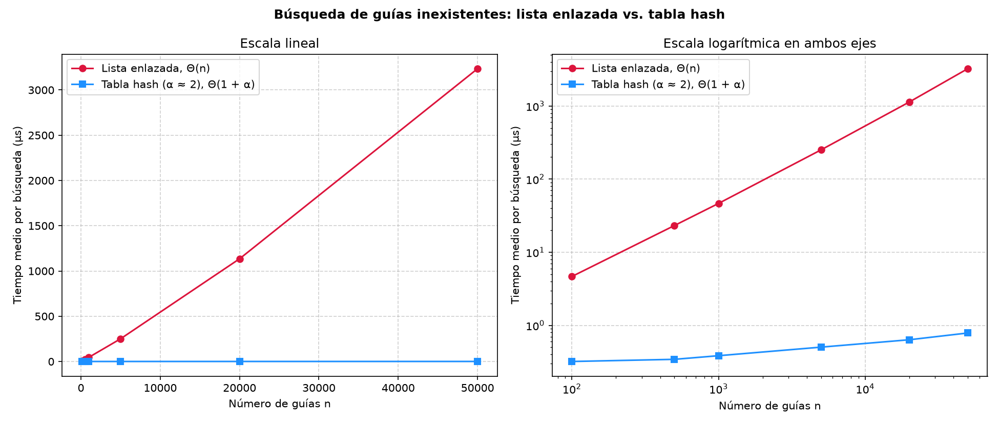
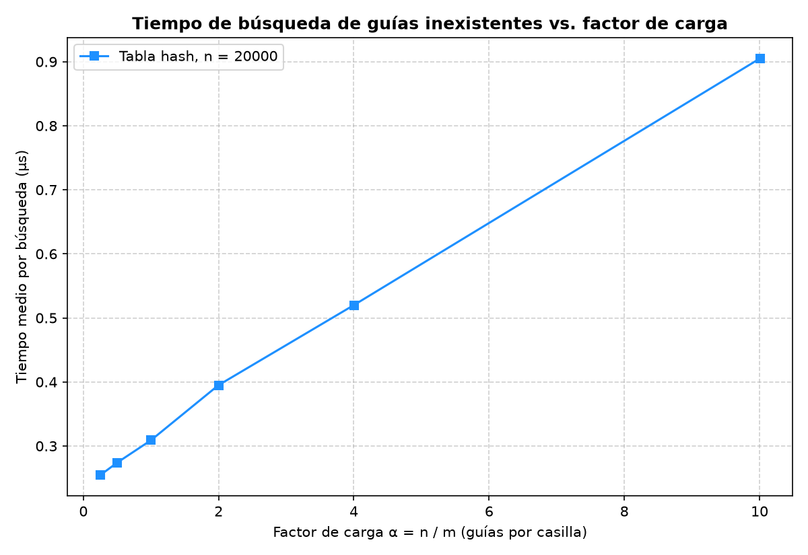

# Laboratorio 3 — Estructuras de datos (Rutas del Caribe)

**Estudiante:** Juliana Gómez Legarda
**Curso:** Análisis de Algoritmos

## Cómo reproducir el experimento

Trabajé en Windows. Todos los comandos se ejecutan desde la carpeta raíz del repositorio (`curso-analisis-algoritmos`).

1. Abrir la carpeta del repositorio en VS Code y abrir la terminal con `Ctrl + Ñ`. En Windows esa terminal es PowerShell y ya queda ubicada en la raíz del repositorio.

2. Activar el entorno virtual:

   ```powershell
   .\venv\Scripts\Activate.ps1
   ```

   Si PowerShell no deja ejecutar el script, primero hay que correr `Set-ExecutionPolicy -Scope Process Bypass` y volver a intentarlo.

3. Instalar las dependencias, que ya están en `requirements.txt` (ahí está matplotlib):

   ```powershell
   pip install -r requirements.txt
   ```

4. Vamos a correr las pruebas. Si todo está bien, al final aparece `Todas las pruebas pasaron.`:

   ```powershell
   python laboratorios\lab3-estructuras-datos\pruebas.py
   ```

5. Ahora vamos a correr la parte de la medición,mmuestra los tiempos en pantalla y guarda las dos gráficas en `laboratorios\lab3-estructuras-datos\graficas\`:

   ```powershell
   python laboratorios\lab3-estructuras-datos\medicion.py
   ```


### Que significan las notaciones

**Para ser mas clara dejo por escrito el uso de las notaciones:**

- **Θ(1)**: tarda lo mismo siempre, haya 100 guías o 5 millones.
- **Θ(n)**: si las guías se duplican, el tiempo también se duplica.
- **Θ(1 + α)**: hay un paso fijo (calcular la casilla) y después tantos pasos como guías haya, en promedio, en esa casilla.
- **Θ(n + m)**: toca pasar por todas las casillas y por todas las guías, una por una.
- **Θ(h + k)**: primero se baja por el árbol, tantos pasos como su altura h, y después se visitan una por una las k guías del rango.

---

## Parte 1 — Implementación y verificación

Código: [estructuras.py](estructuras.py) · [pruebas.py](pruebas.py)

La `ListaEnlazada` agrega cada guía al inicio, lo que cuesta Θ(1), y busca con un `while` que avanza nodo por nodo. La `TablaHash` usa `h(k) = k mod m`, y cada una de sus casillas es una `ListaEnlazada`: cuando dos guías chocan, quedan en la misma lista. No usé `dict`, `set` ni `hash()`. La única operación que recorre toda la colección es la búsqueda de la lista; la tabla solo revisa la casilla que le corresponde a la guía. Para calcular el factor de carga sin contar nada, la tabla lleva el número de guías en `tamano`.

Con `assert` comprobé lo siguiente en `pruebas.py`:

- **Estructuras vacías:** buscar cualquier guía devuelve `None`.
- **La serie de ejemplo** (1000000010, 1000000024, 1000000017, 1000000005): cada guía devuelve su estado, tanto en la lista como en la tabla. Una guía mal digitada (1000000011) devuelve `None` en las dos.
- **La colisión forzada con m = 7:** las guías 10, 24 y 17 caen en la casilla 3, las tres se encuentran después, esa casilla tiene una lista de longitud 3 y las otras seis siguen vacías. También busqué la 31: cae en la misma casilla pero nunca la inserté, así que la búsqueda recorre la cadena completa y debe devolver `None`.
- **El factor de carga:** después de esas tres inserciones da exactamente `3 / 7`.
- **25 colecciones aleatorias** con semilla fija, de 1 a 300 guías y con m entre 1 y 50 (hay tablas muy cargadas, incluso con una sola casilla). En todas, la lista y la tabla devuelven el mismo estado para cada guía que existe, y `None` para 30 guías que no existen. También reviso que el factor de carga sea n / m.

---

## Parte 2 — Medición y gráficas

Código: [medicion.py](medicion.py)

### Cómo lo medí

- **Los datos:** las guías son números distintos de diez dígitos, generados con semilla fija (2026), así que cualquiera puede obtener las mismas. Las guías que no existen salen de la función `generar_guias_inexistentes` de la guía (semilla 7). Para cada n, la lista y la tabla tienen las mismas guías y en las dos busco las mismas 200 guías inexistentes.
- **Qué cronometré:** solo las búsquedas, con `time.perf_counter()`. Armar las estructuras y generar los datos queda por fuera del cronómetro.
- **Una revisión antes de medir:** tomo 100 guías que sí existen y compruebo que la lista y la tabla devuelven el mismo estado.
- **Repeticiones:** cada lote de 200 búsquedas se repite 15 veces y me quedo con la repetición que sea  más rápida, dividida entre 200. Al principio promediaba, pero la tabla daba saltos raros (por ejemplo 1,5 µs donde casi siempre medía 0,4 µs). Pasa porque un lote de la tabla dura apenas unos 60 µs, y cualquier cosa que haga Windows en ese momento lo altera. Por eso hice tres cambios. Me quedo con el tiempo más bajito , porque el ruido solo suma tiempo, nunca lo resta. Intercalo las rondas: en cada una mido todos los casos una vez, y si el computador se pone lento un momento no le pasa a un solo caso. Y apago el recolector de basura mientras cronometro. Con estos cambios, tres ejecuciones seguidas dieron casi los mismos números.

- **Experimento A:** n = 100, 500, 1.000, 5.000, 20.000 y 50.000. En cada uno, m es el primo más cercano a n / 2, para que α quede en 2: m = 47, 251, 499, 2.503, 10.007 y 24.989.


- **Experimento B:** n = 20.000 fijo, y m es el primo más cercano a n / a para a = 0,25; 0,5; 1; 2; 4 y 10. Eso da m = 79.999, 40.009, 19.997, 10.007, 4.999 y 1.999.

### Experimento A — Lista frente a tabla



En esta gráfica se ven las dos estructuras buscando las mismas guías inexistentes. 
A la izquierda, en escala normal, la lista (roja) sube casi en línea recta: con 100 guías tarda unos 5 µs por búsqueda y con 50.000 llega a más de 3.000 µs. La tabla (azul) queda tan abajo que parece pegada al eje. Por eso a la derecha puse las mismas curvas en escala logarítmica: ahí se alcanza a ver que la tabla se mantiene casi plana, entre 0,3 y 0,8 µs, sin importar cuántas guías haya.

### Experimento B — Efecto del factor de carga



Aquí las 20.000 guías son siempre las mismas y solo cambia el número de casillas. Con pocas guías por casilla (α = 0,25) la búsqueda tarda unos 0,25 µs. A medida que α crece, el tiempo sube casi en línea recta, hasta llegar a unos 0,9 µs con α = 10. O sea que  mientras más llenas están las casillas, más larga es la lista que toca recorrer, y se nota en el tiempo.

---

## Parte 3 — Análisis

### 1. Costo teórico

En la lista las guías no tienen ningún orden, así que la que busco podría estar en cualquier nodo. Si no existe, la única forma de saberlo es compararla con los n nodos. Son n comparaciones: Θ(n).

En la tabla primero calculo `k mod m`, que no depende de cuántas guías haya. Después recorro solo la cadena de esa casilla, completa si la guía no está. 
Como las n guías se reparten entre m casillas, cada cadena tiene en promedio n / m = α guías. Sumando las dos partes queda Θ(1 + α). Esto se cumple bajo el **supuesto de hash uniforme simple**: cada guía tiene la misma probabilidad de caer en cualquier casilla, sin importar dónde cayeron las demás. Si todas cayeran en la misma casilla (por ejemplo, con m = 1), esa cadena tendría las n guías y la tabla se volvería una lista: Θ(n).

### 2. Lo medido contra lo esperado

En la primera gráfica, cuando n pasa de 500 a 1.000 (se duplica), la lista pasa de 23,17 a 46,52 µs (×2,01) y la tabla de 0,343 a 0,385 µs (×1,12). Cuando n pasa de 5.000 a 20.000 (×4), la lista pasa de 251,20 a 1.134,97 µs (×4,52) y la tabla de 0,504 a 0,635 µs (×1,26). La lista crece al mismo ritmo que n, como dice Θ(n). La tabla casi no cambia: de n = 100 a n = 50.000 (×500) pasa de 0,321 a 0,786 µs (×2,4), mientras la lista se multiplica por 694. Eso concuerda con Θ(1). Ese pequeño aumento creo que viene de la caché: con más nodos, cada acceso a memoria tarda un poco más.

En la segunda gráfica el tiempo sube casi en línea recta con α: 0,309 µs con α = 1 y 0,905 µs con α = 10. La pendiente es (0,905 − 0,309) / 9 ~ 0,066 µs por cada guía de más en la cadena, y la recta arranca en unos 0,24 µs. Con T ~ 0,24 + 0,066·α, para α = 4 esperaba 0,51 µs y medí 0,520. Esa es justo la forma de Θ(1 + α).

### 3. Las colisiones

Hay colisión cuando dos guías distintas caen en la misma casilla. Con m = 7: 10 mod 7 = 3, 24 mod 7 = 3 y 17 mod 7 = 3. Pasa aunque sobren casillas, porque hay muchísimas más guías posibles (9·10⁹) que casillas y la función no sabe cuáles llegarán. Con solo 4 guías y 7 casillas, la probabilidad de que ninguna choque es 7·6·5·4 / 7⁴ ~ 35 %.

- **Encadenamiento** (el que implementé): la casilla 3 guarda la lista 17 -> 24 -> 10. *Ventaja:* la tabla nunca se llena, aguanta α > 1 y borrar es sencillo. *Costo:* memoria extra para los apuntadores, y los nodos quedan regados.
- **Direccionamiento abierto:** todo se guarda en el mismo arreglo y, si la casilla está ocupada, se prueba otra. Con sondeo lineal, 10 queda en la 3, 24 en la 4 y 17 en la 5. *Ventaja:* no hay apuntadores y aprovecha mejor la caché. *Costo:* necesita α < 1, se forman bloques ocupados que alargan las búsquedas y, para borrar, hay que dejar marcas (lápidas).

### 4. Tabla hash o árbol de búsqueda

Para pedir "las guías entre X y Y" la tabla no sirve: `k mod m` desordena las guías, así que dos guías seguidas terminan en casillas que no tienen relación. Habría que revisarlo todo: Θ(n + m).

Un árbol de búsqueda binario sí guarda el orden: bajo hasta X y recorro en orden hasta pasar Y, con costo Θ(h + k), donde k es la cantidad de guías del rango. El problema es la altura. Si las 400.000 guías llegan ordenadas (lo normal, porque las nuevas tienen números más altos), cada una queda como hijo derecho de la anterior. La altura sería 399.999, y buscar una guía mayor que todas costaría unas 400.000 comparaciones, lo mismo que la lista. En un árbol equilibrado, h = log2(400.000) redondeado hacia abajo = 18 (2¹⁸ = 262.144 y 2¹⁹ = 524.288), unas 19 comparaciones: más de 20.000 veces menos.

### 5. Concepto para la jefa de operaciones

Yp recomiendo usar dos estructuras: una **tabla hash con encadenamiento** para el call center, que aumente m cuando α pase de 2, y un **árbol equilibrado**  para las consultas por rango. Cada guía nueva se guarda en las dos.

**Estimación con 5.000.000 de envíos (es una estimación, no una medición):**

- **Lista:** como mi curva es una recta entonces nos ería un error hacerla mas larga. Con 50.000 guías, revisar cada guía costó 3.234,48 / 50.000 ~ 0,065 µs, así que con 5.000.000 serían unos 5.000.000 × 0,065 ~ 325.000 µs, o sea **unos 0,3 segundos por consulta**. Como ese costo por guía venía subiendo (era 0,047 µs con n = 1.000), espero algo entre 0,35 y 0,5 s.
- **Tabla (α ~ 2):** aquí el tiempo depende de α y no de n. La recta del experimento B da 0,24 + 0,066·2 ~ 0,37 µs; sumando el efecto de la caché del experimento A, estimo **cerca de 1 µs**, unas 300.000 veces menos que la lista. Eso sí, la tabla tiene que crecer: con m fijo en 24.989, α llegaría a 200 y tardaría unos 0,24 + 0,066·200 ~ 13 µs.
